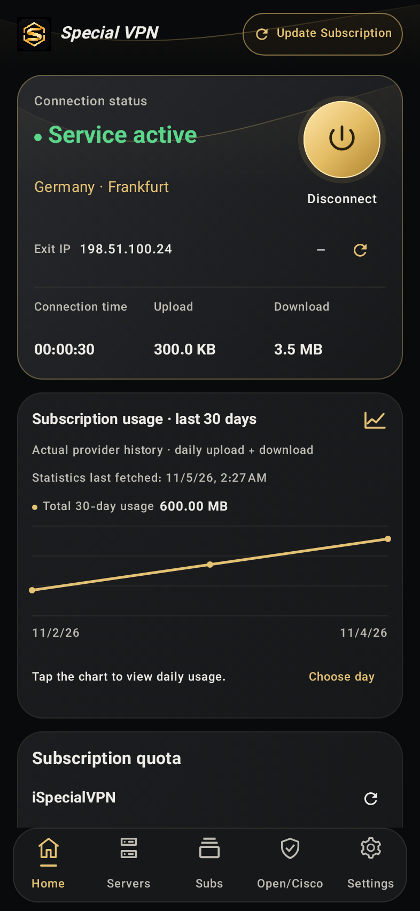
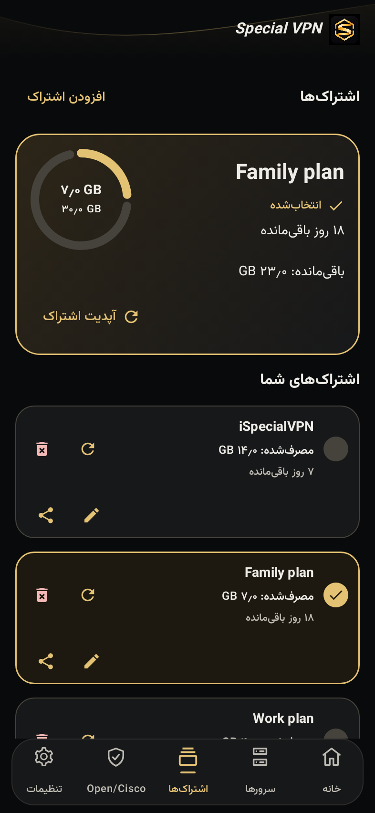
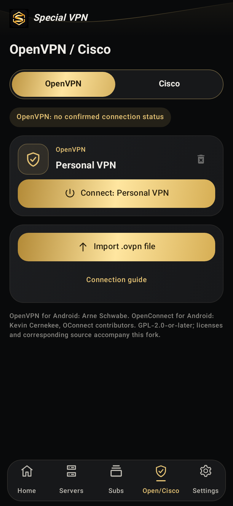

<div align="center">
  
  <h1>Special VPN</h1>
  <p><strong>یک داشبورد. اتصال‌های تو. کنترل کامل.</strong></p>
  <p>رابط مشکی و طلایی · فارسی و انگلیسی · Xray / OpenVPN / Cisco-compatible</p>
  <p>
    <a href="https://github.com/sabialballa/iSpeedTopVPN/releases/tag/v1.6.1"></a>
    
    <a href="LICENSE"></a>
  </p>
  <p><a href="#شروع-سریع">شروع سریع</a> · <a href="#تصاویر-رابط">تصاویر</a> · <a href="#ساخت-و-توسعه">توسعه</a> · <a href="#english">English</a></p>
</div>

---

<div dir="rtl">

Special VPN یک کلاینت اندروید با هویت مستقل و مبتنی بر فورک واقعی [v2rayNG 2.3.14](https://github.com/2dust/v2rayNG/tree/2.3.14) است؛ برای مدیریت اتصال‌ها، اشتراک‌ها و مصرف، با رابطی یکپارچه و پشتیبانی از فارسی راست‌به‌چپ.

**برنامه سرور یا اشتراک رایگان همراه ندارد.** کانفیگ، فایل یا اشتراک خودتان را وارد کنید.

</div>

## دانلود ۱.۶.۱

| فایل | کاربرد |
| :--- | :--- |
| [**Universal Release APK — نصب پیشنهادی**](https://github.com/sabialballa/iSpeedTopVPN/releases/download/v1.6.1/SpecialVPN-1.6.1-universal-release.apk) | امضاشده؛ شامل arm64-v8a، armeabi-v7a، x86 و x86_64 |
| [سورس کامل همراه ورودی‌های ساخت](https://github.com/sabialballa/iSpeedTopVPN/releases/download/v1.6.1/SpecialVPN-1.6.1-source.zip) | آرشیو قابل ساخت با ورودی‌های AAR/SO و سورس هسته‌ها |
| [SHA256SUMS](https://github.com/sabialballa/iSpeedTopVPN/releases/download/v1.6.1/SHA256SUMS-1.6.1.txt) | بررسی یکپارچگی فایل‌ها |
| [گواهی عمومی انتشار](https://github.com/sabialballa/iSpeedTopVPN/releases/download/v1.6.1/SpecialVPN-release-certificate.pem) | تطبیق امضای APK؛ فاقد کلید خصوصی |

حداقل Android 7.0 / API 24 است. شناسهٔ نصب `com.specialvpn.app` است. نسخهٔ Release با کلید انتشار قبلی امضا شده؛ نسخهٔ Debug برای توسعه و دارای امضای متفاوت است. مخزن خصوصی است و دانلود به دسترسی گیت‌هاب نیاز دارد.

## تصاویر رابط

<table>
  <tr>
    <td align="center"><strong>داشبورد اتصال</strong></td>
    <td align="center"><strong>اشتراک‌ها · فارسی</strong></td>
    <td align="center"><strong>پروفایل‌های OpenVPN</strong></td>
  </tr>
  <tr>
    <td></td>
    <td></td>
    <td></td>
  </tr>
</table>

تصاویر، رندر خودِ رابط برنامه با داده‌های آزمایشی‌اند؛ وضعیت یا آمار یک مشتری واقعی نیستند.

## امکانات

| بخش | آنچه در دسترس است |
| :--- | :--- |
| **اتصال** | کنترل اتصال/قطع، زمان اتصال و شمارنده‌های واقعی ترافیک؛ انتخاب سرور و تست تأخیر واقعی Xray |
| **اشتراک‌ها** | دریافت عنوان پنل، انتخاب ساب فعال داشبورد، سهمیه و مصرف، روزهای باقی‌مانده، آپدیت، ویرایش، حذف و اشتراک‌گذاری لینک/QR |
| **نمودار مصرف** | تاریخچهٔ روزانهٔ آپلود + دانلود پاسارگارد، مجموع ۳۰ روز و انتخاب روز برای مشاهدهٔ مصرف |
| **ورود کانفیگ** | لینک، کلیپ‌بورد، فایل و QR؛ مدیریت کانفیگ‌ها و اشتراک‌ها بر پایهٔ امکانات نسخهٔ مبنا |
| **OpenVPN** | ورود فایل مستقل `.ovpn`، ذخیره و حذف پروفایل، نمایش پروفایل متصل بر اساس UUID و دکمهٔ اتصال/قطع همان پروفایل |
| **Cisco-compatible** | اتصال سازگار با AnyConnect از طریق OpenConnect داخلی؛ برنامهٔ رسمی Cisco نیست |
| **هویت و ظاهر** | فارسی RTL و انگلیسی، تم روشن/تیره، لوگوی اختصاصی و پرچم باکیفیت کشور IP خروجی |
| **تنظیمات شبکه** | قابلیت‌های مسیریابی، DNS و حالت‌های اتصال پروژهٔ مبنا |

### دربارهٔ آمار

آمار سهمیه از اطلاعاتی می‌آید که ارائه‌دهنده همراه اشتراک می‌فرستد. نمودار روزانهٔ پاسارگارد از endpoint عمومیِ مخصوص همان اشتراک دریافت می‌شود؛ به کلید مدیریتی پنل نیاز ندارد.

**در ۱.۶.۱، درخواست آمار و نمودار دقیقاً به رفتار ۱.۵.۹ با روزهای UTC برگشته است.** زمان آخرین دریافت می‌تواند تاریخ محلی امروز باشد، در حالی که آخرین نقطهٔ نمودار هنوز مربوط به روز قبل در UTC است. داده و تاریخ ساختگی به نمودار اضافه نمی‌شود. پنل‌هایی که تاریخچهٔ سازگار نمی‌دهند، نمودار روزانهٔ تضمین‌شده ندارند؛ شمارندهٔ سهمیه جایگزین تاریخچهٔ روزانه نمی‌شود.

## شروع سریع

1. فایل **Universal Release APK** را از ریلیز همین مخزن دریافت و نصب کنید.
2. در تب **اشتراک‌ها / Subs**، «افزودن اشتراک» را بزنید و لینک خودتان را وارد کنید؛ کلیپ‌بورد، QR و فایل هم در دسترس‌اند.
3. اشتراک دلخواه را انتخاب کنید؛ کادر طلایی و تیک، ساب انتخاب‌شدهٔ داشبورد را مشخص می‌کنند.
4. در تب **سرورها / Servers**، سرور را انتخاب کنید و مجوز VPN اندروید را تأیید کنید.
5. برای OpenVPN یا Cisco به تب مستقل **Open/Cisco** بروید. اندروید در هر لحظه یک VPN فعال دارد.

برای OpenVPN، فایل مستقل همراه گواهی‌ها و کلیدهای درون فایل را وارد کنید؛ فایل‌های گواهی خارجی و اسکریپت اجرایی وارد نمی‌شوند. راهنمای کامل: [PROTOCOLS-FA.md](PROTOCOLS-FA.md).

## تازه‌های ۱.۶.۱

- بازگشت دریافت و نمایش نمودار پاسارگارد به رفتار UTC نسخهٔ ۱.۵.۹.
- حفظ دکمهٔ **آپدیت اشتراک / Update Sub** در کارت بالایی اشتراک.
- حفظ حذف پروفایل OpenVPN با تأیید، تیک پروفایل واقعاً متصل و تغییر دکمهٔ اتصال/قطع براساس UUID.
- حفظ سایر امکانات و اصلاحات نسخهٔ ۱.۶.۰.

[تغییرات این نسخه](CHANGES-1.6.1.md) · [گزارش بررسی‌ها](VALIDATION-1.6.1.md) · [یادداشت‌های تاریخی](README-HISTORY.md)

## ساخت و توسعه

پروژهٔ اندروید در `V2rayNG/` است. برای بازتولید ساخت تحویلی، **ZIP کامل ریلیز** را بگیرید؛ آرشیو خودکار Source code گیت‌هاب ورودی‌های تولیدشدهٔ نادیده‌گرفته‌شده در Git را تأمین نمی‌کند.

```powershell
cd V2rayNG
.\gradlew.bat :app:assembleFdroidDebug
```

```bash
cd V2rayNG
./gradlew :app:assembleFdroidDebug
```

این فرمان‌ها پس از نصب ابزارها و تنظیم Android SDK اجرا می‌شوند. نسخه‌های ابزار و مراحل آماده‌سازی ورودی‌های بومی در [BUILD-FA.md](BUILD-FA.md) و [NATIVE-ENGINES.md](NATIVE-ENGINES.md) ثبت شده‌اند. برای کار از روی Git، زیرماژول‌ها و ورودی‌های بومی را مطابق همان راهنما آماده کنید.

| مسیر | مسئولیت |
| :--- | :--- |
| `V2rayNG/app/` | اپ، رابط Compose، ViewModelها و منابع |
| `V2rayNG/engine-openvpn/` | اتصال موتور OpenVPN به برنامه |
| `V2rayNG/engine-openconnect/` | اتصال موتور OpenConnect به برنامه |
| `engines/` | سورس و مجوزهای موتورهای واردشده |
| `branding/` | لوگو، منابع پرچم‌ها و مجوزهای بصری |
| `verification/1.6.1/` | شواهد تست و ساخت در ZIP کامل |

### امضا و بررسی

کلید خصوصی انتشار خارج از مخزن نگهداری می‌شود. روش ساخت Release، هم‌ترازی و امضا در [RELEASE-FA.md](RELEASE-FA.md) آمده است.

```text
Release certificate SHA-256
3e70db5bbca2256d8df6b23d459302416e414c53a018d09d46778ddbc2c241a8
```

| بررسی ۱.۶.۱ | نتیجهٔ اجرا |
| :--- | :--- |
| Debug + Release + lint | موفق؛ lint بدون خطا، ۳۷۲ هشدار و ۱ Hint |
| تست‌های JVM و رابط اختیاری | ۲۸۵ موفق از ۲۸۹؛ ۴ تست قدیمی به‌علت نبود `sh` در ویندوز ناموفق |
| امضا، ZIP alignment، پکیج و ورودی‌های Native | موفق؛ ۶۰ کتابخانهٔ بومی با نسخهٔ ۱.۴.۳ یکسان‌اند |
| نصب، اتصال واقعی و تغییر روز روی گوشی | **Not run** — دستگاه یا شبیه‌ساز قابل استفاده متصل نبود |

گزارش کامل شامل محدودیت‌ها و موارد اجرا‌نشده است؛ ساخت موفق به‌معنای تست موفق اتصال به سرور مشتری نیست.

## حریم خصوصی و مجوزها

ردیاب یا تبلیغی به این فورک اضافه نشده است. اطلاعات حساس مشتری، کانفیگ و کلید امضا در فایل‌های انتشار نیستند. آپدیت اشتراک با پنل ارائه‌دهنده تماس می‌گیرد؛ بررسی IP خروجی از ipify و شناسایی کشور همان IP از country.is استفاده می‌کند. پس‌زمینهٔ پرچم‌ها داخل برنامه قرار دارد و از اینترنت دانلود نمی‌شود.

این پروژه مبتنی بر [v2rayNG](https://github.com/2dust/v2rayNG) اثر **2dust و مشارکت‌کنندگان** است و تحت [GPL-3.0](LICENSE) ارائه می‌شود. حقوق مؤلفان اصلی حفظ شده است. نام پوشه‌ها و مخزن برای تداوم تاریخچه باقی مانده‌اند؛ نام نمایشی برنامه **Special VPN** است.

- **OpenVPN for Android:** [schwabe/ics-openvpn](https://github.com/schwabe/ics-openvpn)؛ مجوز و منشأ در [NATIVE-ENGINES.md](NATIVE-ENGINES.md).
- **OpenConnect wrapper:** [pengyue-polaron/oconnect-android](https://github.com/pengyue-polaron/oconnect-android)؛ سازگار با AnyConnect، بدون وابستگی رسمی به Cisco.
- **Vazirmatn:** فونت با مجوز OFL؛ منابع در `branding/fonts/`.
- **flag-icons:** تصاویر پرچم با مجوز MIT؛ [منابع و مجوز](branding/FLAGS.md).

---

## English

**Special VPN** is an Android client built from a real v2rayNG 2.3.14 fork, with a black-and-gold Compose interface, Persian RTL and English support, subscription management, and embedded OpenVPN/OpenConnect integrations.

- **Download:** use the signed Universal Release APK in [v1.6.1](https://github.com/sabialballa/iSpeedTopVPN/releases/tag/v1.6.1), Android7.0+, four ABIs. Supply your own subscription or configuration; no server is bundled.
- **Usage charts:** PasarGuard daily provider history, upload + download combined. Version1.6.1 restores1.5.9 UTC request/label behavior. Quota metadata and daily history are distinct; provider support is required.
- **Build:** use the full source release asset for bundled build inputs. Follow [BUILD-FA.md](BUILD-FA.md), [engine provenance](NATIVE-ENGINES.md) and [signing instructions](RELEASE-FA.md).
- **Validation:** Debug/Release/lint and APK checks passed.285/289 tests passed; four existing Windows tests require unavailable `sh`. No device installation or live VPN connection test was run. See [validation](VALIDATION-1.6.1.md).
- **License:** GPL-3.0 host; original v2rayNG and third-party notices retained. This is not the official Cisco app. Private release signing keys are never included.
